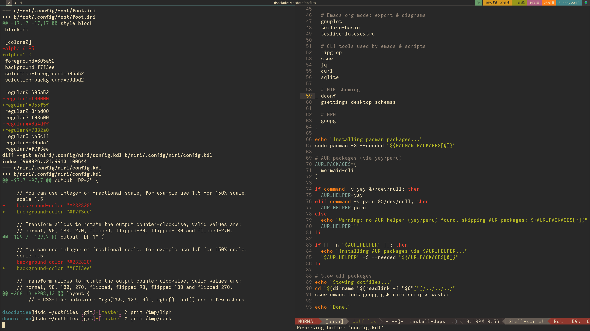
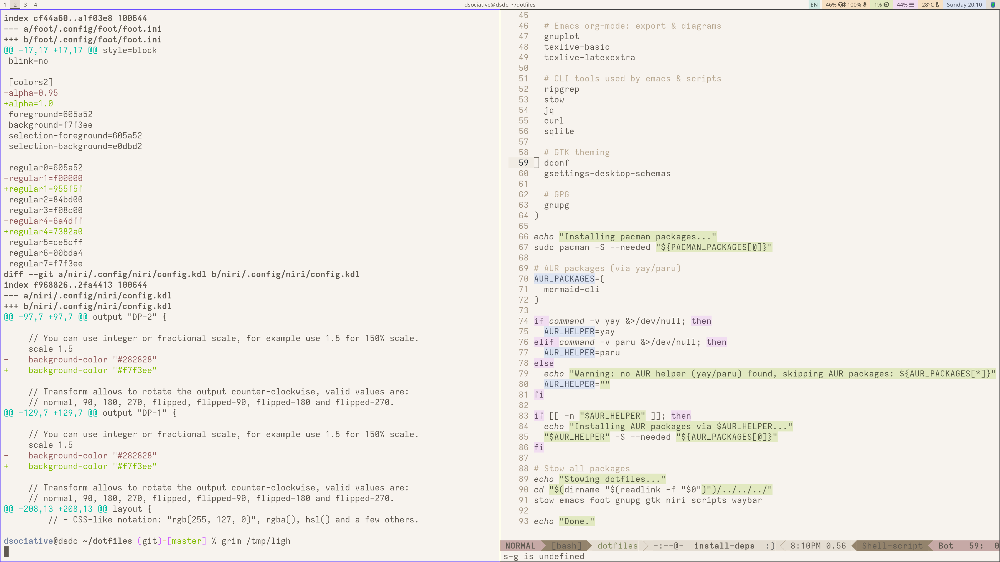

# dotfiles

Arch Linux setup managed with [GNU Stow](https://www.gnu.org/software/stow/). Hyprland compositor, kitty terminal, Emacs, waybar.

## Screenshots

### Dark (Gruvbox)


### Light (Flatwhite)


## Install

```bash
git clone git@github.com:dsociative/dotfiles.git ~/dotfiles
cd ~/dotfiles
./scripts/.local/bin/install-deps
```

## Theme toggle

`Mod+N` switches between dark (gruvbox) and light (flatwhite) across all apps: kitty, emacs, waybar, hyprland, GTK.

## Eco mode

`Mod+B` (or the 🍃 in waybar) toggles a low-power mode for running off battery:
disables the second monitor, drops the remaining one to 60 Hz, caps CPU
(no turbo, EPP `power`, 35 W RAPL package limit) and GPU (250 W), and switches
to the dark theme. Idle draw ~180 W → ~95 W.

`install-deps` installs a small root helper to `/usr/local/bin/ecomode-power`
and a `/etc/sudoers.d/ecomode` drop-in so the toggle runs the privileged knobs
(RAPL, `intel_pstate`, `nvidia-smi`) without a password prompt.
